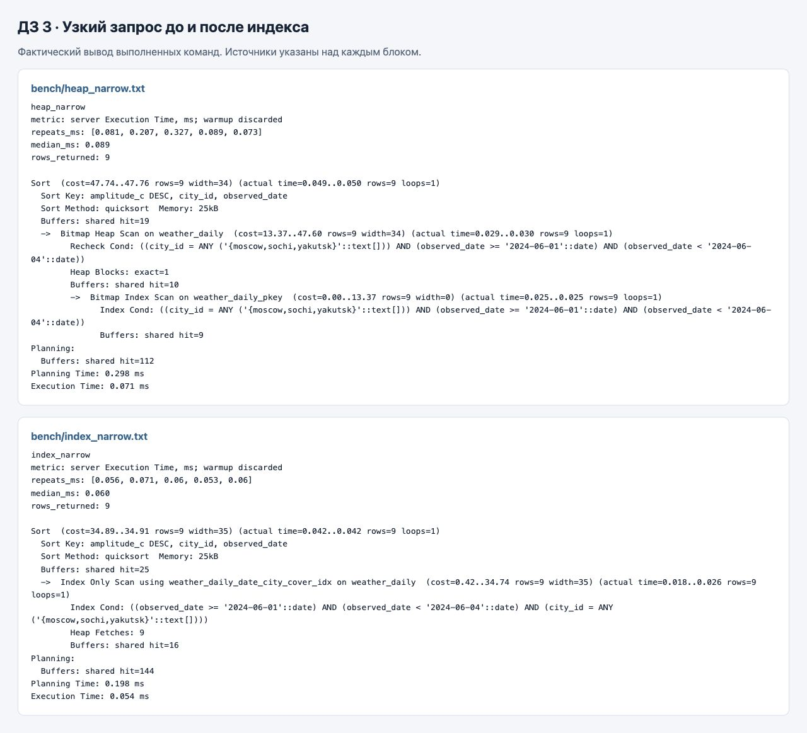
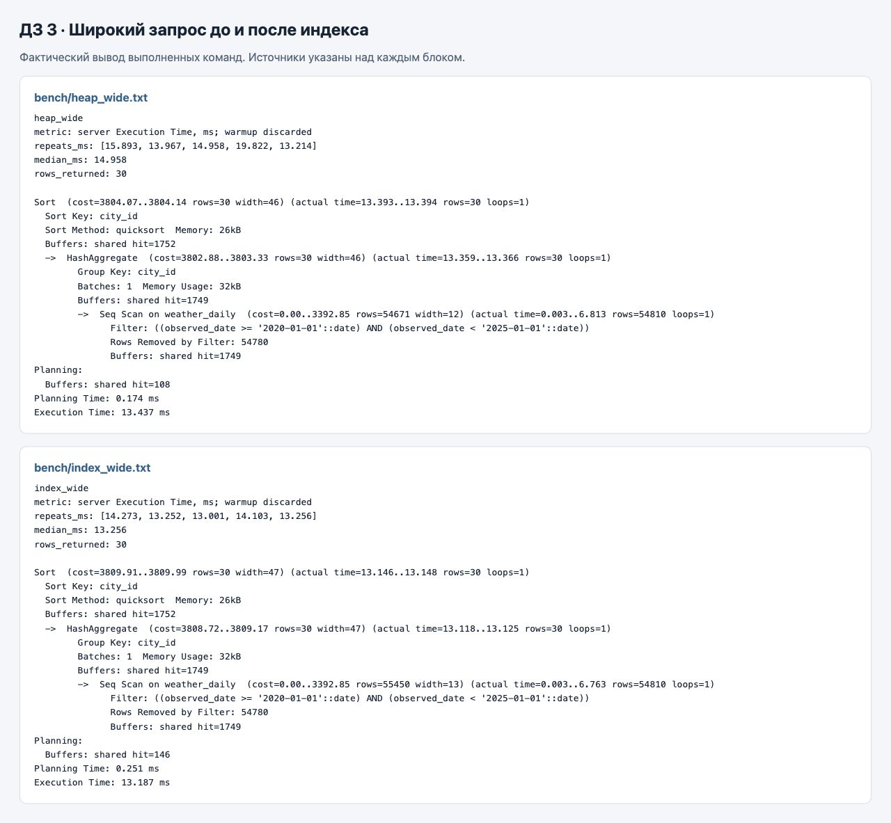
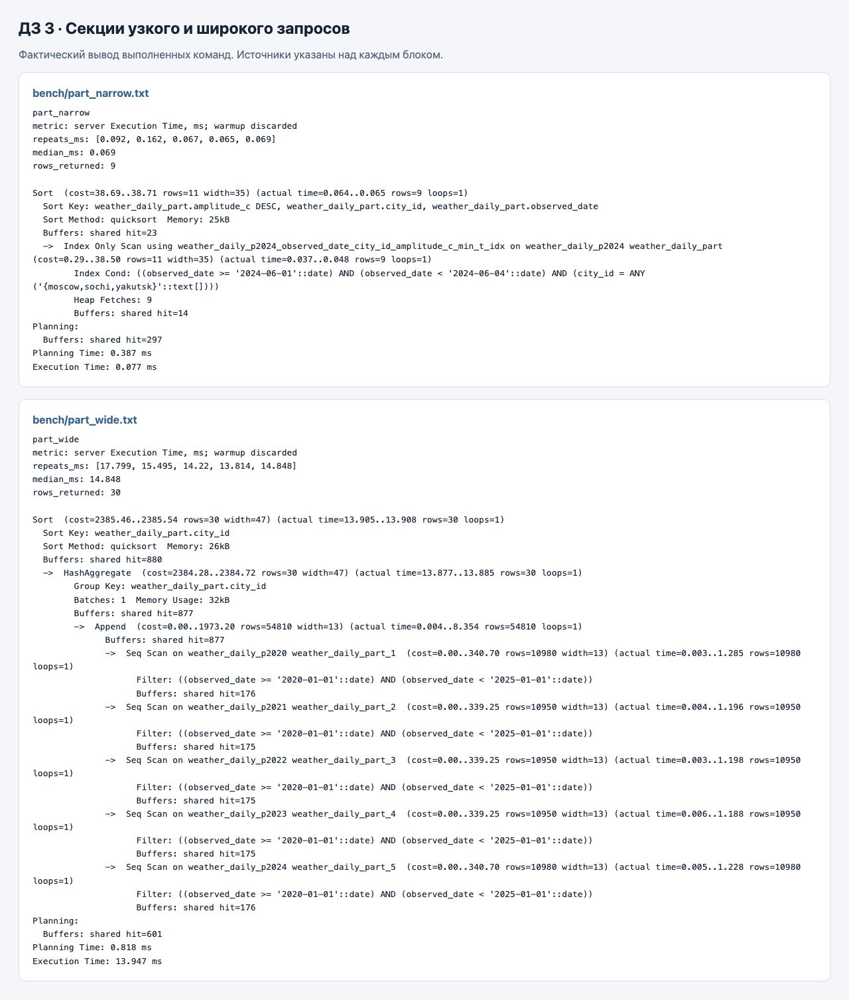
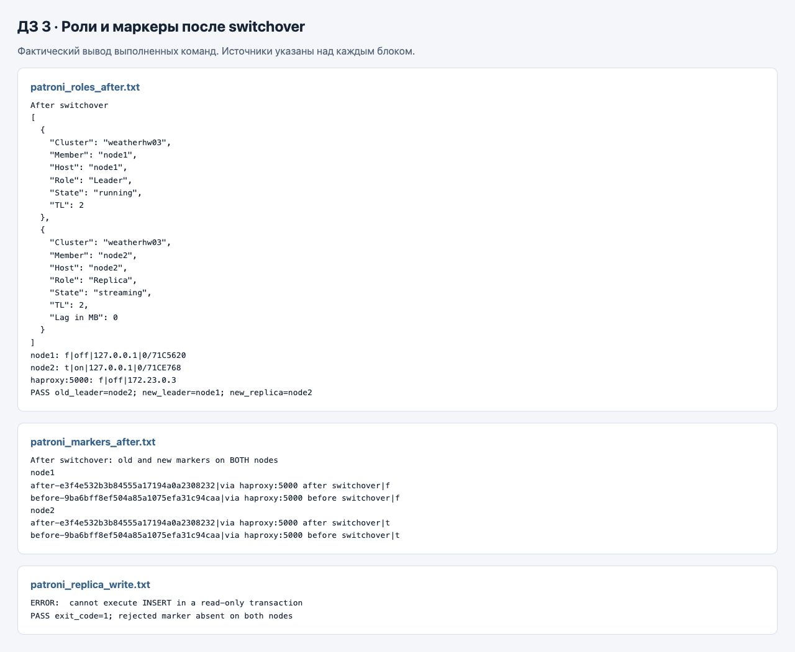
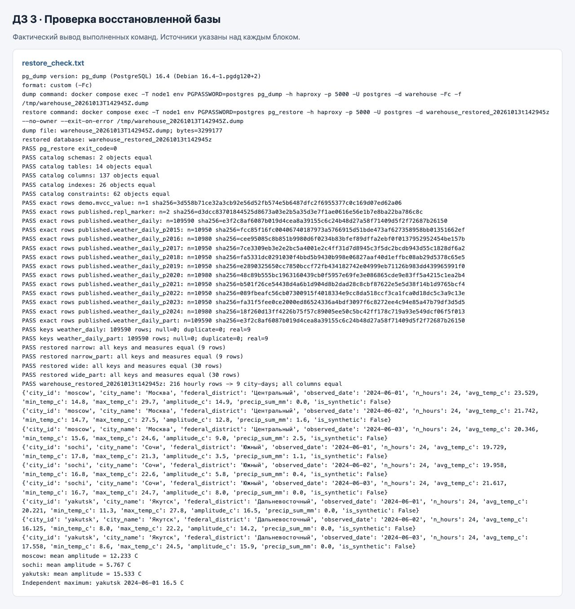
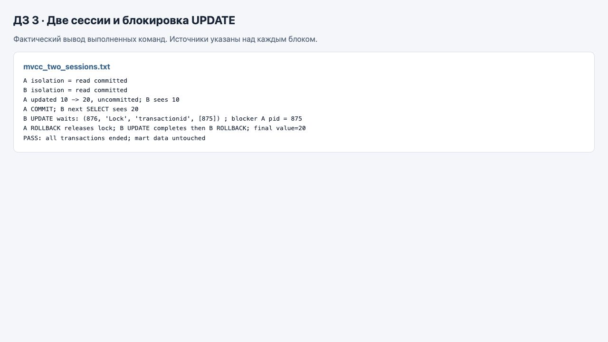

# Отчёт по администрированию и оптимизации PostgreSQL

Бабаев Минходжхон. Фактический запуск 13 октября 2026 года, завершён в 17:30 МСК. Погодная витрина ДЗ 2 сохранила исходный результат после дополнительного B-tree индекса, секционирования, смены лидера и логического восстановления. Секционирование уменьшило объём чтения широкого запроса, однако его время осталось сопоставимым с исходным вариантом.

## Предметная область и данные

Потребитель — аналитик климата. Бизнес-вопрос контрольного отчёта: в какие дни 1–3 июня 2024 у Москвы, Сочи и Якутска суточная амплитуда температуры была наибольшей. Исходный факт ДЗ 2 — час UTC в городе с ключом `(city_id, observed_at)`. Витрина — город × день UTC с ключом `(city_id, observed_date)`. Узкий результат сохраняет эту гранулярность; широкий — одна строка на город со средней дневной амплитудой за пять лет и числом дней.

Источник контрольных 216 часов — [Open-Meteo Historical Weather API](https://open-meteo.com/en/docs/historical-weather-api), CC BY 4.0. Срез перенесён из ДЗ 2 через сохранённые `weather.csv` и `city.csv`; SHA-256 файлов совпали с ДЗ 2 ([манифест](evidence/source_manifest.json)). Исходный загрузчик не задавал `models`, поэтому конкретную модель нельзя подтвердить по CSV. Атрибуты города в этом срезе постоянны.

Меры: `avg_temp_c`, `min_temp_c`, `max_temp_c`, `amplitude_c=max-min` в °C; `precip_sum_mm` — сумма осадков за сутки в мм; `n_hours` — число часов. Все сутки определены по UTC. Соединение со справочником использует `city_id`; уникальность результата обеспечивает пара `city_id, observed_date`. Проверяются заполненность ключей, уникальность, 24 часа на контрольные сутки и равенство всех мер независимо от SQL.

Измерительный набор содержит 109 590 строк за 2015-01-01–2024-12-31: девять реальных контрольных суток и 109 581 синтетическую строку. В узкий фильтр попадают 9 строк, или 0,008212%; в широкий — 54 810, или 50,013687%. Узкий запрос возвращает 9 строк; широкий агрегирует выбранные дни в 30 строк.

### Генерация синтетики

[Генератор](scripts/generate_synth.py) задаёт 30 городов: три реальных идентификатора и `syn_01`–`syn_27`. На каждую из 3653 дат приходится строка каждого города, кроме девяти реальных ключей 1–3 июня 2024. У всех искусственных строк `is_synthetic=true`, включая другие даты Москвы, Сочи и Якутска.

Псевдослучайное число определяется первыми четырьмя байтами MD5 строки `city|date|salt`, делёнными на 2^32. Отдельные соли используются для средней температуры, амплитуды, отклонения дневной средней и осадков. Отдельного изменяемого seed нет. Климатические параметры для Москвы — базовая средняя 10 °C и амплитуда 12 °C, Сочи — 16 и 6 °C, Якутска — −5 и 18 °C. У искусственного города с номером i базовая средняя равна −8+i, амплитуда — 8+(i mod 7).

Средняя изменяется синусоидально по дню года с амплитудой 12 °C, для Якутска — 19,2 °C, и шумом примерно от −2 до +2 °C. Дневная амплитуда получает шум от −3 до +3 °C с нижней границей 1,5 °C. Минимум и максимум округляются до 0,1 °C, средняя — до 0,001 °C; осадки равномерно распределены примерно от 0 до 8 мм и округляются до 0,01 мм. `n_hours=24` здесь — параметр синтетической дневной витрины, а не доказательство наличия часовых наблюдений.

Набор равномерно покрывает даты и города, не моделирует пропуски, корреляцию соседних дней и реалистичное распределение дождей. Длинный отчёт по этому набору не описывает реальный климат.

## Окружение и метод измерения

PostgreSQL 16.4, Patroni 3.3.2, etcd 3.5.16, HAProxy 2.9.15. Python на хосте 3.14.7, внутри контейнера 3.11.2. Docker client 29.8.0, server 29.5.2, Compose 5.5.1. Хост macOS arm64; VM Docker — 6 CPU и 12 513 603 584 байта памяти, около 11,65 GiB. Каждый PostgreSQL-узел ограничен 1 CPU и 768 MiB, shared_buffers — 128 MiB.

Для каждого запуска фиксируются UTC, `work_mem=16MB`, `jit=off`, `max_parallel_workers_per_gather=0`. `enable_seqscan=on`, `enable_partition_pruning=on`; cost-параметры не подгонялись. Лидер во время всех измерений один и тот же; switchover выполняется после измерений. Оба варианта имеют одинаковые данные и SQL, для секций меняется только имя таблицы.

После загрузки и изменения организации выполнены VACUUM и ANALYZE. Для каждого из шести сочетаний варианта и запроса выполнен один исключённый прогрев и пять измеряемых повторов `EXPLAIN (ANALYZE, BUFFERS, FORMAT JSON)`. Метрика — серверный `Execution Time` в миллисекундах, без клиентского Docker/psql времени. Planning Time и оценочная стоимость cost не входят в медиану.

Это измерения после прогрева. В последнем измеряемом плане каждого варианта `shared read=0`; страницы были доступны в shared buffers. Называть эксперимент проверкой холодного диска нельзя. На VM работают другие контейнеры, отдельные повторы колеблются; различия в десятки микросекунд узкого запроса не дают основания для общего обещания ускорения. Читаемый TXT-план получен дополнительным запуском; точные планы всех пяти измеряемых повторов находятся в JSON.

Полные версии, зависимости и идентификаторы образов: [environment.txt](evidence/environment.txt). Команды запуска с нуля и остановки с сохранением томов: [README](README.md). Лог успешно завершённого сценария: [run_all.txt](evidence/run_all.txt).

## Запросы и измерения

Узкий запрос — три контрольных города за полуоткрытый интервал [2024-06-01, 2024-06-04). Сортировка: амплитуда убывает, затем город и дата. Широкий — все 30 городов за [2020-01-01, 2025-01-01), средняя амплитуда и число дней на город.

| Организация | Запрос | Все пять времён в мс | Медиана в мс | Строк результата | Совпадение |
|---|---|---|---:|---:|---|
| Таблица с PK | Узкий | 0,081; 0,207; 0,327; 0,089; 0,073 | 0,089 | 9 | Базовый |
| Таблица с PK | Широкий | 15,893; 13,967; 14,958; 19,822; 13,214 | 14,958 | 30 | Базовый |
| PK и покрывающий индекс | Узкий | 0,056; 0,071; 0,060; 0,053; 0,060 | 0,060 | 9 | Да |
| PK и покрывающий индекс | Широкий | 14,273; 13,252; 13,001; 14,103; 13,256 | 13,256 | 30 | Да |
| Годовые секции с такими же индексами | Узкий | 0,092; 0,162; 0,067; 0,065; 0,069 | 0,069 | 9 | Да |
| Годовые секции с такими же индексами | Широкий | 17,799; 15,495; 14,220; 13,814; 14,848 | 14,848 | 30 | Да |

SQL: [узкий](sql/narrow.sql), [широкий](sql/wide.sql), [узкий по секциям](sql/narrow_part.sql), [широкий по секциям](sql/wide_part.sql). Результаты и планы текстом: [heap narrow](evidence/bench/heap_narrow.txt), [heap wide](evidence/bench/heap_wide.txt), [index narrow](evidence/bench/index_narrow.txt), [index wide](evidence/bench/index_wide.txt), [partition narrow](evidence/bench/part_narrow.txt), [partition wide](evidence/bench/part_wide.txt). Файлы JSON с теми же именами сохраняют времена и планы каждого повторения.

### B-tree индекс

Исходная таблица уже имеет B-tree первичного ключа `(city_id, observed_date)`. Поэтому baseline не означает таблицу вообще без индексов: узкий исходный план использует Bitmap Index Scan по PK и Bitmap Heap Scan, читая одну heap-страницу.

Дополнительный индекс имеет ключ `(observed_date, city_id)` и INCLUDE для `amplitude_c, min_temp_c, max_temp_c, avg_temp_c`. Дата первой ограничивает короткий непрерывный диапазон и поддерживает широкий фильтр без города; второе поле уточняет город внутри интервала. Имеющийся PK уже поддерживает равенство города с диапазоном даты. Дополнительный индекс проверяет другую физическую организацию и покрытие мер, а не дублирует PK. INCLUDE не делает поля частью ключа поиска и не обеспечивает сортировку по амплитуде.

В узком плане появился Index Only Scan. При этом `Heap Fetches=9`: сервер всё ещё обращался к heap для проверки видимости строк. Покрытие столбцов само по себе не гарантирует нулевые heap fetches; PostgreSQL использует visibility map. Медиана уменьшилась с 0,089 до 0,060 мс, но shared hit верхнего узла вырос с 19 до 25. Это небольшой локальный эффект, а не доказательство уменьшения всей работы базы.

Для широкого запроса и до, и после индекса выбран Seq Scan: 54 810 подходящих строк, 54 780 исключённых, 1749 shared hit на чтении таблицы. Половина таблицы нужна отчёту; последовательный проход разумнее множества индексных обращений. Медианы 14,958 и 13,256 мс получены при том же типе плана, поэтому разницу нельзя приписать использованию нового индекса.

Дополнительный индекс занимает 6 455 296 байт, около 6,16 MiB; индекс PK — 3 661 824 байта. INSERT/UPDATE требуют его поддержки, занимают место и создают дополнительный WAL. DDL: [02_index.sql](sql/02_index.sql). Ограничения и исходная таблица: [01_heap.sql](sql/01_heap.sql).

### Годовое секционирование

Ключ RANGE — `observed_date`, поскольку оба отчёта фильтруют даты. Созданы десять секций 2015–2024. Граница каждой секции — [1 января текущего года, 1 января следующего); начало включено, конец исключён. Первичный ключ включает ключ секционирования, поэтому уникальность города и даты допустима на родительской таблице.

На секционированной таблице есть PK и тот же дополнительный покрывающий индекс. Данные совпадают, SQL не меняет фильтры или агрегаты. Следовательно, сравнение индексированного варианта с секциями отделяет изменение организации от добавления индекса.

В узком плане присутствует только `weather_daily_p2024`; остальные девять секций исключены при планировании. В широком плане Append содержит только `p2020, p2021, p2022, p2023, p2024`. Статическое исключение секций видно по отсутствию остальных таблиц; `Subplans Removed=0` не опровергает исключение на этапе планирования.

Широкий запрос читает 877 shared hit на Append против 1749 на исходном Seq Scan, а внутри выбранных секций не отбрасывает строк по дате. Верхний узел имеет 880 против 1752 hit. Однако пять Seq Scan и Append добавляют накладные расходы: медиана 14,848 мс не лучше 13,256 мс индексированной обычной таблицы и близка к 14,958 мс baseline. Уменьшение числа страниц не гарантирует пропорционального ускорения.

Цена — десять секций, локальные индексы и управление будущими границами. Родитель не хранит данные; размеры секций необходимо суммировать. Обычная таблица занимает 14 327 808 байт данных и 10 117 120 байт индексов; размеры всех секций сохранены в [sizes.json](evidence/sizes.json). Секционированный вариант хранится параллельно исходному для сравнения, поэтому стенд дополнительно дублирует данные. DDL: [03_partition.sql](sql/03_partition.sql).

Генерация заняла 0,965 с; загрузка с VACUUM — 1,255 с; создание индекса с VACUUM — 0,232 с; создание секций, перенос и VACUUM — 1,147 с. Это отдельное клиентское время setup-команд с накладными расходами Docker; оно не смешивается с серверными миллисекундами отчётов ([setup_costs.json](evidence/setup_costs.json)).

## Проверка правильности

После индекса обе упорядоченные выборки точно сравниваются с сохранённым baseline. После секционирования дополнительно выполняется двусторонний EXCEPT ALL для обоих запросов и для полных таблиц со всеми столбцами. Во всех направлениях число различий равно нулю. Это проверяет значения и кратность, а не только количество строк.

Независимый Python-контроль использует Decimal и исходные hourly CSV. Проверены 24 различных часа на каждые сутки, все девять ключей, средняя, минимум, максимум, амплитуда, сумма осадков, справочные атрибуты и признак синтетики.

Контрольный максимум — Якутск 2024-06-01, 16,5 °C. Средняя суточная амплитуда по трём реальным дням: Москва 12,233 °C, Сочи 5,767 °C, Якутск 15,533 °C. Это вывод только для трёх суток, а не обобщение на климат города.

Подтверждения: [после индекса](evidence/equality_index.txt), [после секций](evidence/equality_partition.txt), [после остальных опытов](evidence/equality_final.txt), [независимый контроль](evidence/independent_control.txt). Проверки завершаются ошибкой при несовпадении.

## Patroni и репликация

Кластер состоит из двух PostgreSQL-узлов под Patroni и одного etcd DCS. Учебная база `warehouse` создаётся и загружается через текущего лидера HAProxy :5000 непосредственно в этом кластере. На реплике отдельно подтверждены 109 590 строк витрины. Реплика не является другим пустым кластером.

До переключения фактический лидер — node2, node1 — streaming replica. Роли проверены и через `patronictl list --format json`, и через SQL `pg_is_in_recovery()` и `transaction_read_only`. На лидере значения false/off, на реплике true/on.

Через маршрут записи создан уникальный маркер `before-9ba6bff8ef504a85a1075efa31c94caa`. Скрипт опрашивает конкретную реплику до его появления с ограниченным ожиданием, а затем читает там запись. Обычный INSERT на реплике завершился `cannot execute INSERT in a read-only transaction`, exit code 1; отвергнутый уникальный маркер отсутствует на обоих узлах.

Плановая команда:

```bash
docker compose exec -T node1 patronictl -c /tmp/patroni.yml \
  switchover --leader node2 --candidate node1 --force
```

Здесь `--force` отключает интерактивное подтверждение Patroni; лидер и кандидат заданы явно. После завершения node1 стал лидером, node2 — streaming replica, timeline увеличился с 1 до 2. Подключение через HAProxy :5000 подтвердило false/off, то есть клиент пишет в доступный для записи узел.

Старый маркер сохранился. Новый `after-e3f4e532b3b84555a17194a0a2308232` записан через тот же маршрут и прочитан на новой реплике. Оба маркера показаны на обоих узлах с правильными ролями; оба аналитических ответа после switchover равны baseline.

Switchover — плановая передача роли при доступных узлах. Failover — выбор нового лидера после недоступности прежнего, с учётом состояния DCS и пригодности реплики. В асинхронной репликации подтверждённая клиенту запись может ещё не быть применена репликой; при отказе возможно потерять последние изменения. `maximum_lag_on_failover=1048576` ограничивает допустимое отставание кандидата, но не превращает репликацию в синхронную. TTL=30 с, loop_wait=10 с, retry_timeout=10 с; время переключения нельзя обещать как точную константу.

Один etcd и два контейнера на одной VM не доказывают устойчивость к отказу ноутбука или DCS. Автоматический failover остановкой лидера не испытывался: требуемый switchover выполнен, оба узла в рабочем состоянии.

Фактические выводы: [до переключения](evidence/patroni_roles_before.txt), [маркер на реплике](evidence/patroni_marker_replica.txt), [отказ записи](evidence/patroni_replica_write.txt), [switchover](evidence/patroni_switchover.txt), [роли после](evidence/patroni_roles_after.txt), [оба маркера](evidence/patroni_markers_after.txt), [контроль после](evidence/patroni_control_after_switch.txt).

## Логическая копия и восстановление

Утилита `pg_dump` 16.4 создала custom archive через файловый `-Fc -f` внутри контейнера; `docker compose cp` сохранил бинарный файл на хост. Текстовых преобразований бинарного dump нет.

```bash
docker compose exec -T node1 env PGPASSWORD=postgres \
  pg_dump -h haproxy -p 5000 -U postgres -d warehouse \
  -Fc -f /tmp/warehouse_20261013T142945Z.dump
docker compose cp node1:/tmp/warehouse_20261013T142945Z.dump \
  backups/warehouse_20261013T142945Z.dump
docker compose exec -T node1 env PGPASSWORD=postgres \
  psql -h haproxy -p 5000 -U postgres -d postgres -v ON_ERROR_STOP=1 \
  -c "CREATE DATABASE warehouse_restored_20261013t142945z;"
docker compose exec -T node1 env PGPASSWORD=postgres \
  pg_restore -h haproxy -p 5000 -U postgres \
  -d warehouse_restored_20261013t142945z \
  --no-owner --exit-on-error /tmp/warehouse_20261013T142945Z.dump
```

Файл занимает 3 299 177 байт. Восстановление завершилось с кодом 0 в новую базу `warehouse_restored_20261013t142945z`; исходная `warehouse` сохранена.

Проверено точное равенство двух схем, 14 таблиц/родительских таблиц/секций, 137 описаний столбцов, 26 индексов и 62 ограничений, включая определения, границы секций и NOT NULL. Эти числа описывают объекты каталога, а не количество независимых наборов фактов.

Для каждой таблицы исходной и восстановленной базы CSV выгружен в бинарный временный поток с сортировкой по всем столбцам. Совпали число строк, размер и SHA-256; это дополнение к проверкам ключей и конкретных ответов. У двух вариантов витрины по 109 590 строк, нулевые NULL/дубли ключей, девять реальных контрольных строк. Полные выгрузки исключают незамеченные различия вне узкого среза.

Узкий и широкий ответы из обеих физических таблиц совпали с исходной базой и baseline. Независимый контроль восстановленной базы снова получил 216 часов → девять суток и максимум Якутска 16,5 °C. Объекты `demo.mvcc_value` и оба маркера также восстановлены.

PostgreSQL не поддерживает обычное обращение вида `database.schema.table` к другой базе. Сравнение выполняется отдельными соединениями к двум базам в [backup_restore.py](scripts/backup_restore.py), без выдуманного межбазового SQL. Подтверждения: [restore_check.txt](evidence/restore_check.txt), [каталоги](evidence/restore_catalog.json), [метаданные копии](evidence/restore_metadata.json). Полный бинарный dump в отчёт и архив сдачи не включён.

## Две сессии и механизмы PostgreSQL

Опыт выполнен на отдельной маленькой таблице `demo.mvcc_value`, исходная витрина не изменялась. Оба рабочих соединения используют READ COMMITTED. Третье соединение только наблюдает ожидание блокировки.

Сессия A обновила 10 → 20 без COMMIT и сама увидела 20. Сессия B прочитала 10. После COMMIT сессии A следующий SELECT сессии B увидел 20, хотя это то же соединение: в READ COMMITTED каждый оператор получает новый снимок видимости. MVCC хранит версии строки; незавершённая версия чужой транзакции не видна обычному SELECT. [Описание READ COMMITTED](https://www.postgresql.org/docs/16/transaction-iso.html).

Во второй части A сделала незавершённый UPDATE 20 → 30. B попыталась изменить ту же строку на 40 и ожидала: `wait_event_type=Lock`, `wait_event=transactionid`, `pg_blocking_pids(B)=[A]`. После ROLLBACK A второй UPDATE завершился, затем B тоже выполнила ROLLBACK. Конечное значение осталось 20. Все рабочие транзакции завершены, соединения закрыты; SELECT не был заблокирован незавершённым UPDATE, а конкурирующий UPDATE ожидал. Вывод опыта: [mvcc_two_sessions.txt](evidence/mvcc_two_sessions.txt).

Обнаружить ожидающую сессию можно запросом:

```sql
SELECT pid, state, wait_event_type, wait_event, pg_blocking_pids(pid)
FROM pg_stat_activity
WHERE wait_event_type = 'Lock';
```

WAL — журнал изменений, который должен быть записан перед соответствующими изменениями страниц данных. После сбоя PostgreSQL воспроизводит необходимые записи журнала относительно checkpoint, восстанавливая состояние страниц. Физическая streaming replication передаёт WAL реплике, где записи применяются к копии базы. Передача WAL и видимость COMMIT — связанные, но разные этапы. [Документация WAL](https://www.postgresql.org/docs/16/wal-intro.html).

Репликация не заменяет копию: ошибочное удаление или UPDATE будут переданы реплике. Отдельная сохранённая копия позволяет восстановить прежнее состояние. Данный dump сохраняет согласованное логическое состояние базы на момент снятия, но не роли всего кластера, DCS и не последующие изменения.

Логическое восстановление создаёт объекты и загружает строки через SQL; индексы строятся заново. Физическая копия сохраняет файлы кластера; base backup вместе с сохранённой цепочкой WAL позволяет довести восстановление до выбранного момента при корректно настроенном архивировании. PITR и промышленное резервирование здесь не настраивались. [Резервирование PostgreSQL](https://www.postgresql.org/docs/16/backup.html), [pg_dump](https://www.postgresql.org/docs/16/app-pgdump.html).

## Скриншоты выполнения

Это снимки браузерного представления фактических файлов вывода команд, сохранённые через браузерный инструмент. Исходные текстовые и JSON-выводы приложены отдельно; изображения их не заменяют. На каждом снимке указаны проверка и файлы-источники.













## Соответствие критериям задания

| Критерий | Подтверждение |
|---|---|
| Два исходных запроса, прогрев и пять повторов | SQL, шесть JSON/TXT файлов bench, таблица всех времён |
| Обоснование B-tree и сопоставление узкого и широкого | Порядок полей, INCLUDE, планы и размеры индексов |
| Ключ и границы секций, читаемые секции | DDL, только p2024 и p2020–p2024 в планах |
| Равенство ключей и мер | Baseline, двусторонний EXCEPT ALL, независимые 216 часов |
| Роли и новая запись на реплике | SQL ролей и уникальный before-маркер |
| Switchover, старые и новые данные | Явная команда, timeline 2, два маркера на обоих узлах |
| Отклонение записи и объяснение ограничений | Ошибка read-only, отсутствие маркера, switchover/failover |
| Логическое восстановление в отдельную базу | Custom dump, CREATE DATABASE, pg_restore exit 0 |
| Объекты, ключи и ответы восстановленной базы | Каталоги, полные SHA-256, NULL/дубли, оба запроса |
| Две сессии, MVCC, WAL и блокировки | READ COMMITTED, незавершённый UPDATE, pg_blocking_pids и завершение транзакций |

[EXPLAIN и BUFFERS](https://www.postgresql.org/docs/16/sql-explain.html), [секционирование](https://www.postgresql.org/docs/16/ddl-partitioning.html), [index-only scan](https://www.postgresql.org/docs/16/indexes-index-only-scans.html), [Patroni REST API](https://patroni.readthedocs.io/en/rel_3_3/rest_api.html) объясняют механизмы; измерения и проверки в этом отчёте получены на приложенном локальном стенде.
